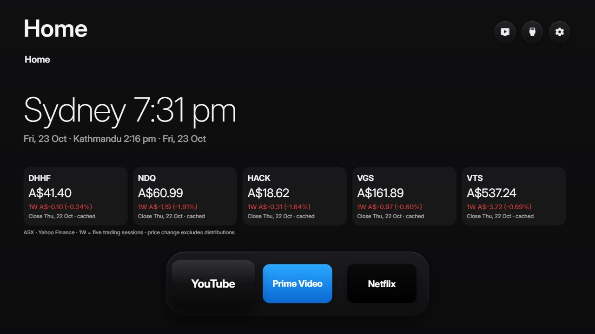
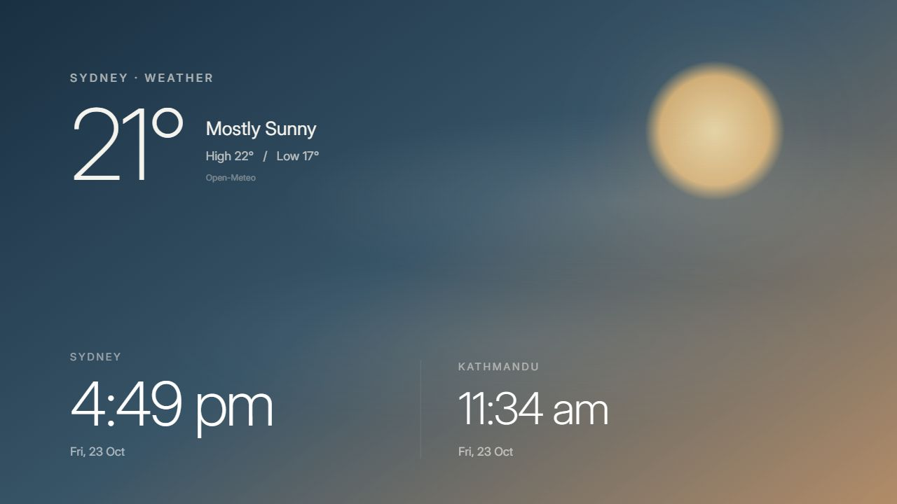

# Debloat TV

A personal home screen for Samsung Tizen TVs, customised from [Free My TV](https://github.com/simbasjungles/free-my-tv). Streaming shortcuts, Sydney weather, dual city clocks and ETF prices in a simple interface.

Runs directly on the TV. A computer is needed to build/install updates, but not for everyday use or automatic startup.

## Home screen



*Current browser preview. Prices are dated examples. The browser sample app list does not include Alexa; installed TV apps determine which shortcuts appear.*

## Customised features

- **Editable app shelf:** YouTube, Prime Video, Netflix and Alexa as defaults when installed. Add, remove and reorder through **Home Settings → Shelf**.
- **Newer Samsung Prime Video support:** recognises `org.tizen.primevideo` without selecting companion/helper apps.
- **Sydney and Kathmandu clocks:** explicit timezones, Sydney daylight saving and Kathmandu's 45-minute offset.
- **Sydney weather:** Celsius, current conditions, high/low temperatures and hourly forecast.
- **Weather screensaver:** a minimal weather-responsive sky, subtle cloud motion, weather details and both clocks. Appears after five minutes idle.
- **ETF cards:** DHHF, NDQ, HACK, VGS and VTS, with individual visibility toggles. Latest completed closing price plus five-session change in dollars and percent.
- **TV-local startup helper:** opens Free My TV after boot or a detected standby wake. One-second checks and delay; actual timing depends on firmware. Disable it in Home Settings.
- **Simplified home:** Movies/Shows navigation removed, recommendation requests disabled on Home, cryptocurrency prices disabled.
- **TV shortcuts:** live TV, HDMI inputs, installed apps and TV settings.

True Continue Watching and playback progress from Netflix/Prime are unavailable. Inherited Recently opened code only records titles selected through the recommendation interface; with that interface removed, it is not a general viewing-history feature.

## Weather screensaver



*Daytime browser preview. Night, overcast, rain and snow use different background treatments.*

## Compatibility

Tested by the owner on a **2025 Samsung UA43U8500FWXXY running Tizen 9**, including automatic startup. Other models and firmware are unverified.

Samsung's original home screen stays available. Despite the name, this custom Samsung build does not uninstall system apps. Upstream Android and LG sources remain in the repository; these custom features target the Samsung web app.

## Build and preview

Requires Python 3:

```sh
git clone https://github.com/sabin567/Debloat-TV.git
cd Debloat-TV
python tizen/build.py
```

The first build creates ignored `config.properties` from the example. Adjust location and units there and rebuild. This custom home does not require a TMDB key.

```sh
python tizen/build.py --preview
python -m http.server 8765 --directory out/tizen
```

Open `http://localhost:8765`. Browser previews use sample apps and cannot fully test Samsung networking or firmware behaviour.

## Install

Enable Developer Mode on the TV with the computer's local IP as Host PC IP, then restart the TV. The WGT must be signed for the TV; the boot service requires a suitable Samsung partner-level certificate.

With Samsung's signing tools and a configured certificate profile:

```sh
python tizen/build.py --sign YOUR_PROFILE
python tizen/install.py YOUR_TV_IP
```

Keep the same author certificate for updates. A different certificate prevents an in-place update. Signing keys, credentials, local configuration and compiled packages are excluded from Git.

## Data and security

- Weather comes from Open-Meteo.
- ETF history comes from Yahoo Finance. Prices are completed daily closes, not real-time quotes. Refresh attempts occur every 15 minutes while open. Weekly means five trading sessions; changes exclude distributions. Cached prices are dated and marked when refresh fails. Provider availability and TV networking can affect updates.
- The watchlist contains public ticker/price information only: no brokerage accounts, quantities, balances or account identifiers.
- The startup helper checks the TV's loopback power-state endpoint and launches Free My TV. It does not expose a remote command server.
- Keep API keys in ignored local configuration. Do not share compiled packages that contain credentials.
- The third-party TizenBrew installer used in development disables TLS validation for signing requests. It is not included here; prefer a deployment workflow with certificate validation enabled.

## Attribution

Based on [simbasjungles/free-my-tv](https://github.com/simbasjungles/free-my-tv). Original history, attribution and [MIT licence](LICENSE) are retained.

See [CUSTOMIZATIONS.md](CUSTOMIZATIONS.md) for implementation notes and [the upstream README](docs/UPSTREAM_README.md) for the original project documentation.
